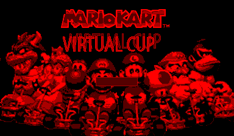
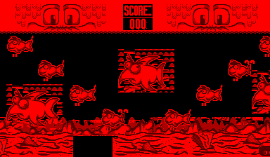
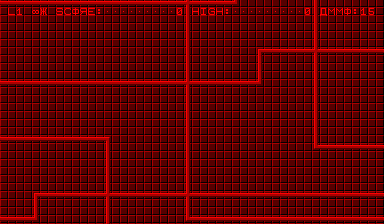
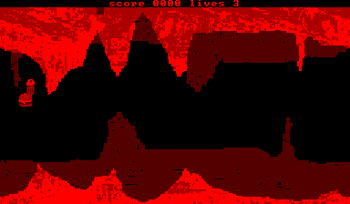
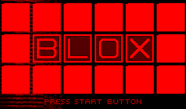
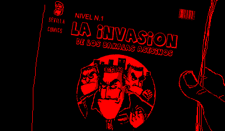
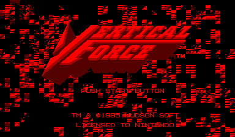

# vbrecomp

## What it is

vbrecomp statically recompiles Virtual Boy ROMs into native C and links that C against a small hardware runtime (CPU state, VIP video, VSU audio, timers, input), so each game becomes a native executable. Think [N64Recomp](https://github.com/N64Recomp/N64Recomp), for Nintendo's red-and-black 1995 console.

The retail library is small enough to recompile all of it, and that is the goal: every game in the corpus in game, through one generic driver with no game-specific code. The recompiler, the runtime and every game live in this one repo, so a fix found on one title is measured on all of them.

Part of the sp00nznet recomp family ([snesrecomp](https://github.com/sp00nznet/snesrecomp), [ps3recomp](https://github.com/sp00nznet/ps3recomp), [xboxrecomp](https://github.com/sp00nznet/xboxrecomp), ...) and follows its shared house style: layout, `--headless --record` flags, conformance reporting, and no ROMs or generated code in the repo.

## Status

**Alpha, unversioned.** Four commercial titles get into gameplay headless with nothing but Start and A pressed: Space Squash, Insmouth no Yakata, T&E Virtual Golf and the Bound High prototype. The work is getting the rest past their boot, warning and menu screens.

| | |
|---|---|
| Instruction conformance (`tools/conformance.py`, runs in CI) | **77 / 77** |
| ROMs in the corpus | 76 (28 retail, 3 proto, 45 homebrew) |
| Recompile and compile clean | **76 / 76** |
| Put something on screen | **66 / 76** (44 advancing, 22 drew once and froze) |
| Blank | 10, of which 3 are blank on hardware too |
| In game | **4** (Space Squash, Insmouth no Yakata, T&E Virtual Golf, Bound High) |

The frozen half is not one thing: measured against hardware (`scripts/reference/motion.py`), **16 are gated** -- our picture is identical at frames 300, 600 and 900 while hardware advances -- and **13 are parked on both sides**, where neither emulator leaves the boot screen and a matching score proves nothing. The count reads 64 rather than the 66 measured in an earlier session because Bound High and Virtual Bowling draw nothing in this one; they are blank against the previous `vip.c` too, so it is not the renderer, and the cross-session flip is still unexplained. All of it runs through the **generic driver** (`games/driver/main.c`) -- no game-specific glue: the recompiler emits the discovered interrupt handlers + reset vector, and the driver wires them up. Three of the 12 that draw nothing are blank on real hardware too -- the three Snowball Wars demos, which never load a single character byte on the Mednafen VB core in 1800 frames. **So the honest denominator is 73, not 76.** Capitan Sevilla 3D and Null Pointer Mockup were on that list until the reference capture was found to be holding buttons that never reached the emulated pad (BizHawk names them `P1 Start`, not `Start`); with input actually applied they both draw on hardware, so they are ours to fix.

Per-game state, retail first: [`COMPATIBILITY.md`](COMPATIBILITY.md). What each non-rendering game is stuck on, with evidence: [`docs/RENDER_TRIAGE.md`](docs/RENDER_TRIAGE.md).

## Screenshots

| | | | |
|:--:|:--:|:--:|:--:|
|  |  |  |  |
| Mario Kart: Virtual Cup | Fishbone | Soviet Union 2011 | Hamburgers en Route to Switzerland |
|  |  |  | |
| BLOX | Capitan Sevilla 2 | Vertical Force | |

All recompiled to C and booted through the shared generic driver, captured headless at frame 600-900 from the current build.

## Getting Started

ROMs are not included and never will be: supply your own `.vb` dumps of cartridges you own. Everything runs locally and the recompiled code stays on your machine.

### Quick start

1. Download this repository (green **Code** button, **Download ZIP**) and unzip it.
2. Double-click **`Setup.cmd`**.
3. It checks for the Visual Studio 2022 C++ Build Tools, CMake, Python 3 and SDL2, and asks before installing any that are missing (it says what and how big). Then it asks for your ROM, or picks up the one in `roms/`.
4. It builds the recompiler, runs the instruction check, recompiles your ROM and builds it. If something fails it says what to do in one sentence and keeps the details in `setup.log`. Run it again to resume.
5. Double-click the **`Play <game>.cmd`** it leaves next to `Setup.cmd`.

Keys: arrows = left pad, I/J/K/L = right pad, Z = A, X = B, A/S = L/R, Enter = Start, Right Shift = Select.

### Step by step

[`docs/GETTING_STARTED.md`](docs/GETTING_STARTED.md) is the technical route, with the expected output of each step; `Setup.cmd` runs exactly its steps 1-5. In short:

```powershell
vcpkg install sdl2:x64-windows
cmake -S . -B build -T host=x64 -DSDL2_DIR=C:/vcpkg/installed/x64-windows/share/sdl2
cmake --build build --config Release --target v810recomp
py -3 tools/conformance.py                                  # expect: 77/77 cases pass
build/Release/v810recomp.exe "roms/Vertical Force (USA).vb" corpus/Vertical_Force_USA
cmake -S . -B build_all -T host=x64 -DSDL2_DIR=C:/vcpkg/installed/x64-windows/share/sdl2 -DVBRECOMP_CORPUS_DIR=$PWD/corpus -DVBRECOMP_BUILD_TESTS=OFF
cmake --build build_all --config Release --target corpus_Vertical_Force_USA
build_all/games/Release/corpus_Vertical_Force_USA.exe "roms/Vertical Force (USA).vb"
```

Usual trip-ups: `python` may be the Microsoft Store alias (use `py -3`); a tool installed a moment ago needs a new terminal window to be on `PATH`; `-T host=x64` is not optional (below).

## Usage

```powershell
# Play (windowed)
build_all/games/Release/corpus_<slug>.exe "roms/<game>.vb"

# Headless: no window, no audio; works over RDP. --frames bounds the run.
build_all/games/Release/corpus_<slug>.exe --headless --frames 900 "roms/<game>.vb"

# Record 600 frames to an mp4 (ffmpeg on PATH; implies --headless)
build_all/games/Release/corpus_<slug>.exe --record out.mp4 --frames 600 "roms/<game>.vb"

# Recompile, with committed profile-guided hints where a game has them
build/Release/v810recomp.exe "game.vb" out_dir [--hints games/hints/<slug>.hints.txt]

# The whole corpus
./scripts/sweep.ps1            # recompile + syntax-check all -> STATUS.md
./scripts/build_all.ps1        # build every game
./scripts/render_survey.ps1    # boot every game headless, classify what it drew
./scripts/regress.ps1          # fixed panel of games against a committed baseline
```

`--headless`/`--frames` are the `VBRECOMP_HEADLESS`/`VBRECOMP_HEADLESS_FRAMES` environment variables; the rest of the knobs (screenshots, auto-press, tracing) are listed in [GETTING_STARTED](docs/GETTING_STARTED.md#useful-environment-variables).

## Building from source

Requires CMake 3.15+, MSVC (Visual Studio 2022 Build Tools), SDL2 via vcpkg, and Python 3 for the conformance suite.

```powershell
# -T host=x64 is not optional: the generated C for the largest ROMs is one
# translation unit of several hundred thousand lines, and the 32-bit hosted
# compiler CMake picks by default runs out of address space on it
# ("C1060: compiler is out of heap space").
cmake -S . -B build -T host=x64 -DSDL2_DIR="C:/vcpkg/installed/x64-windows/share/sdl2"
cmake --build build --config Release
build/Release/test_mem.exe
py -3 tools/conformance.py
```

Without SDL2 the runtime builds with a stub platform layer (headless only). With [recomp-netlab](https://github.com/sp00nznet/recomp-netlab), `netlab check vbrecomp --on testbox` builds that on the clang-cl farm and runs `test_mem` on a test VM. CI (`.github/workflows/build.yml`) runs the same build, `test_mem` and the conformance suite on every push.

## How it works

```
  ROM (.vb)
     │
     ▼
  ┌──────────────────┐   discovers functions via control-flow analysis,
  │  v810recomp      │   translates each V810 routine to a C function
  │  (tools/)        │   (vb_func_<addr>), resolves jumps, jump tables
  └──────────────────┘
     │  generated/recomp_funcs.c  (human-readable C, see below)
     ▼
  ┌──────────────────┐   games/driver/main.c wires up the entry point,
  │  vbrecomp runtime│   interrupt handlers, and the frame loop, then
  │  (src/, include/)│   links the generated C against the runtime:
  └──────────────────┘     CPU · VIP · VSU · timers · input · SDL2
     │
     ▼
  native game executable
```

The recompiled output is meant to be **read**, not just run. Flag math is factored into named helpers, every line carries its original address and disassembly, and functions get header comments:

```c
/* sub_07F80026: 0x07F80026-0x07F8004A (36 bytes), IRQ level 2 handler */
void vb_func_07F80026(void) {
    /* 07F80026: add  -4, r3 */
    vb_cpu.r[3] = vb_add(vb_cpu.r[3], 0xFFFFFFFC);   /* r3 = sp */
    /* 07F80028: st.w r31, 0[r3] */
    vb_mem_write32(vb_cpu.r[3] + (int32_t)(int16_t)0x0000, vb_cpu.r[31]);
    ...
```

## Corpus-driven hardening

Every ROM in the library is a test case. The recompiler is only as good as the worst ROM it chokes on, so we run it against **all of them** and treat each failure as a concrete bug:

1. **Recompile everything** — `scripts/sweep.ps1` runs `v810recomp` on every ROM and syntax-checks the generated C with MSVC. Output: [`STATUS.md`](STATUS.md) (auto-generated compile matrix) + `corpus/results.json`.
2. **Fix what breaks** — each ROM that fails to recompile or compile is a decoder/analysis/codegen gap to fix in `tools/v810recomp`.
3. **Boot & render** — bring games up one at a time, factoring common patterns (frame sync, decompressors) into shared helpers so each new game is less manual.
4. **Cross-validate** — an independent Ghidra V810 disassembly is diffed against our function table to catch missed functions, data-misparsed-as-code, and boundary disagreements, and to source real function names. See [`docs/RECOMPILER.md`](docs/RECOMPILER.md#cross-validation).

Progress is tracked in [`COMPATIBILITY.md`](COMPATIBILITY.md), updated as we go.

- Getting there took repeated passes of the same loop: find a shared correctness bug, fix it once, measure the whole corpus. Recent ones:
  - **A world is clipped by the screen, not skipped by it.** The same mistake twice, in opposite directions, both in the VIP's world loop. Worlds with `W` or `H` over 512 were dropped outright -- but a world may be far wider than the display and hardware just clips it, so Insecticide's `W=704` background never drew and the game rendered its objects and HUD on black. And `sy < VB_SCREEN_HEIGHT` bounds a *world*-space index by a *screen*-space limit, which only holds when the origin is non-negative: Soviet Union 2011 parks its background at `GY=-212, H=447` so world rows 224-447 land on screen, and the bound stopped at 223, truncating exactly the visible part. That world went from 0 to 69,426 pixels and the game from 5.5% of the screen lit to 80.9%, matching hardware's own frame-to-frame motion (80.4% against 80.3%).
  - **A function was made out of a call's arguments.** The V810 long-call idiom passes arguments *inline*, in the bytes after the `jal`; the callee reads them through `r31` and returns past them. Those argument bytes had a function made out of them and were decoded as code -- and in Galactic Pinball the first halfword, `0x9800`, decodes as `bp .`, a branch to itself that the caller fell into and spun in for the whole run. The idiom is now detected from the `add N, r31` before `jmp [r31]`, and a split point must be a real instruction boundary. Galactic Pinball went from 1,232 to 9,442 non-zero character writes and from blank to drawing.
  - **The pad only updated when a game asked for it.** `SDLR`/`SDHR` returned a snapshot refreshed only on an `SCR_START` write, but the VB can also read the pad itself -- so a game relying on that saw zero buttons forever. Jack Bros stores the *rising edges* of the pad as its kernel's task-dispatch flags, so a pad frozen at zero has no edges: its scheduler ran 3 times in 700 frames and every task that loads graphics never ran.
  - **A `jmp` after a PC-capture long call is not the end of the flow.** `jal .+4` / `add N, r31` / `jmp [rX]` returns to the address `r31` now holds, but the trace stopped at the `jmp`, so function epilogues after it were emitted *nowhere* -- every virtual call in SPONG returned into a hole.
  - **Careful with pacing when measuring control flow.** A frame is a count of `vb_interrupt_check()` calls and that is emitted at every function entry, so a change to how the ROM is carved into functions changes the frame rate. One change looked like it destroyed Elevated Speed (231,461 non-zero character writes down to 7,667) and at a higher tick count produces 221,142 -- nothing was miscompiled. Measure at more than one tick count before calling a regression.
  - **The column table was mapped onto the world attributes.** `0x3DC00-0x3DFFF` is the VIP's per-column brightness ramp, not a mirror of `0x3D800`, so every game that wrote one wiped all 32 worlds with it. StarFox had loaded 7,350 CHR bytes and set up a 380x224 world, then read it back as `GX=254 GY=254` -- 254 being `0x00FE`, the column value landing on top of it.
  - **The VIP's VER register reads back 2, and games test it.** Hyper Fighting (Beta) spun on `andi 0x0002` of `0x0005F844` forever -- 14.4 million CHR writes in 400 frames -- because an unimplemented register returned 0. VIP registers also mirror every 0x80 bytes, which we were not decoding.
  - **`jmp [r31]` after a stack switch is a context resume, not a return.** Ordinary code only adds to `r3`; replacing it wholesale from memory is either a task switch or a save/restore pair, told apart by whether a matching `st.w r3` exists. Jack Bros' cooperative scheduler resumes tasks this way and we were emitting a plain return, so its tasks were created and never ran.
  - **A `jal` off the top of ROM wraps within the CART**, which repeats every `rom_size` bytes -- not to the bottom of the 27-bit map. Hyper Fighting calls `0x08000290` from `0x07C20906`, one mirror period past its 4 MB ROM at `0x07C00000`; masking gave `0x00000290`, inside VIP memory, and seven calls in its boot were dropped.
  - **`andi imm, reg, r0` is the V810 TEST idiom** -- the result is discarded, the flags are not. Skipping it because the destination is `r0` left the next branch reading stale flags; 3-D Tetris's VIP handler tested FRAMESTART that way and drew nothing at all.
  - **`jal <next instruction>` is not a call**, it is the compiler's PC-capture idiom for a long call; emitting it as one ran the following instructions twice with `r31` already advanced.
  - **A drained tail target is jumped to, not called**, so raising the call depth for it made the target's own `jmp [r31]` read as a return and unwound the transfer chain.
  - **The VIP interrupt line is level-triggered** on `INTPND & INTENB`; requesting it once per frame dropped every source but the first a handler happened to service.
  - **Profile-guided function discovery** (`scripts/discover.ps1`): the runtime counts jump targets it could not resolve, those are fed back as `entry` hints, and the loop repeats to a fixpoint. Hints are committed per game under `games/hints/`.
- Earlier passes in the same style, kept because the reasoning still applies:
  - **ROM-mirror jump normalization** — reset vectors built as low-mirror (`movhi 0x0700`) or `jmp [r31]` computed jumps were mistaken for returns, so the entry never ran (dead boot, SP=0). Fixing both took the most games from "boots dead" to "boots."
  - **VIP status-register phase cycling** (DPSTTS/XPSTTS) — games poll these for a specific display/drawing phase; cycling through each phase (instead of a 2-state toggle) lets their frame-sync loops terminate.
  - **V810 interrupt-priority masking** was inverted (it masked the high-priority VIP interrupt whenever a game raised `PSW.I`); fixed to accept `level ≥ PSW.I`.
  - **State-machine jump-table detection** — the ubiquitous `ld.w table[idx]; … jmp [rN]` dispatch (with the continuation loaded into `r31` between) and low-mirror table entries are now resolved, so game main-loop state machines dispatch correctly.
  - **Interrupt-handler discovery** for push-prologue vector stubs, plus a runtime guard so a missing handler can't wedge the CPU with `EP` stuck set.
- A reusable **`rename` recompiler hint** lets a hand-written `src/main.c` intercept specific functions (HLE), used by the **Red Alarm** and **Mario's Tennis** custom drivers.

Full per-game state: [`COMPATIBILITY.md`](COMPATIBILITY.md). What each non-rendering game is actually stuck on, with the screenshot evidence: [`docs/RENDER_TRIAGE.md`](docs/RENDER_TRIAGE.md). Detailed fix notes: [`docs/RECOMPILER.md`](docs/RECOMPILER.md).

## Repository layout

```
include/vbrecomp/   public runtime API (cpu, mem, vip, vsu, timer, gamepad, ...)
src/                runtime implementation + SDL2 platform + ImGui menu
tools/v810recomp/   the static recompiler (decode, analyze, emit)
games/driver/       the generic driver -- boots any recompiled ROM, no game-specific code
games/hints/        committed per-game profile-guided entry points
games/<name>/       five older titles with hand-written boot glue (generated C is NOT committed)
scripts/            corpus sweep, build, survey, regression panel, hardware comparison
docs/               getting started, architecture, recompiler internals, render triage
THIRD_PARTY.md      what is vendored, and what is NOT ours to license
COMPATIBILITY.md    living per-game status
STATUS.md           auto-generated compile matrix (from sweep.ps1)
```

## Documentation

- [`docs/ARCHITECTURE.md`](docs/ARCHITECTURE.md) — Virtual Boy hardware, memory map, the VIP renderer, validated technical fixes.
- [`docs/RECOMPILER.md`](docs/RECOMPILER.md) — how `v810recomp` works, the hints format, the readability design, the corpus workflow, and Ghidra cross-validation.
- [`docs/GETTING_STARTED.md`](docs/GETTING_STARTED.md) — ROM in, recompiled game out, and how to reproduce the corpus numbers.
- [`docs/RENDER_TRIAGE.md`](docs/RENDER_TRIAGE.md) — every measured finding, including the changes that were reverted and why.

## Credits

- [SDL2](https://www.libsdl.org/) — windowing, input, audio.
- [Dear ImGui](https://github.com/ocornut/imgui) — menu bar and toasts (via [sp00nznet/tools](https://github.com/sp00nznet/tools)).
- [stb_image_write](https://github.com/nothings/stb) — screenshots.
- [rustual-boy](https://github.com/emu-rs/rustual-boy) — reference for VIP/VSU behavior (architecture reference only; all vbrecomp code is original).
- [Ghidra_v810_v830](https://github.com/20Enderdude20/Ghidra_v810_v830) by 20Enderdude20 — V810 processor module used for independent cross-validation.

## License

MIT, see [LICENSE](LICENSE). Every file we wrote carries an SPDX tag. Vendored third-party code (Dear ImGui, stb) is listed in [NOTICE](NOTICE) with its licence texts in [LICENSES/](LICENSES/); [THIRD_PARTY.md](THIRD_PARTY.md) has the detail.

Recompiled output is a machine translation of the ROM it came from, so it is never committed: `corpus/` and `games/*/generated/` are gitignored and regenerate from your ROM in one command. No ROMs are included.
